# 🚀 MAPEUS Simulator - Software-Architectur (MVC)

## 🗺️ Interaktives Class Diagramms

> 💡 **Tipp für das Review:
> 
> 👉 **[MAPEUS Architektur-Diagramm in voller Größe (Mermaid Live Editor) anzeigen](https://tinyurl.com/mermaidUMLrefactorMMM)

---

## 💻 UML (Mermaid Syntax)

```mermaid
classDiagram
    direction TB

    %% --- CONFIGURATION INJECTIONS ---
    constants ..> GameController : supplies global limits & thresholds
    constants ..> Rocket : supplies dimensions & structural weights
    constants ..> TerminalView : supplies terminal frame-width & speed settings
    constants ..> ArchiveService : supplies metadata keys
    constants ..> WeatherService : supplies fallback parameters
    constants ..> MassPropertiesCalculator : supplies physical multipliers
    catalog ..> GameController : supplies experiment catalog registries

    %% --- ARCHITECTURAL MVC & STATE RELATIONSHIPS ---
    GameController "1" *-- "1" Rocket : owns and orchestrates (Model)
    GameController "1" *-- "1" Mission : drives and queries timeline (State Model)
    GameController "1" *-- "1" TerminalView : delegates all player communication (View)
    
    GameController ..> WeatherService : queries meteorological telemetry (Service)
    GameController ..> ArchiveService : invokes FAIR-RDM persistence serialization (Service)
    GameController ..> DeSpinCalculator : triggers physical boundary safety audits (Physics Facade)
    
    Rocket "1" *-- "0..15" Module : aggregates modules within predefined grid (Composition)
    Rocket ..> MassPropertiesCalculator : delegates inertia & mass calculation vectors (Physics Facade)

    %% --- PACKAGE BOUNDARY / FACADE INTERFACES ---
    physics_init ..> DeSpinCalculator : exposes endpoint
    physics_init ..> MassPropertiesCalculator : exposes endpoint
    physics_init ..> GameController : serves clean API functions

    %% --- CLASS DEFINITIONS ---
    class constants {
        +str MISSION_NAME
        +float ROCKET_BASE_INERTIA
        +float ROCKET_BASE_MASS
        +int MAX_PAYLOAD_SLOTS
        +int ASSEMBLY_BUFFER_SLOTS
        +int MAX_WORKBENCH_SLOTS
        +float INERTIA_PER_BIO
        +float INERTIA_PER_TEC
        +float MASS_PER_BIO
        +float MASS_PER_TEC
        +str LAUNCH_SITE_NAME
        +float LAUNCH_SITE_LAT
        +float LAUNCH_SITE_LON
        +float MIN_WIRE_LENGTH
        +float MAX_WIRE_LENGTH
        +float MAX_ALLOWABLE_WIND_SPEED
        +float DEFAULT_WIND_SPEED
        +int SPEED_VIZ
        +int TERMINAL_WIDTH
    }

    class catalog {
        +dict EXPERIMENTS
    }

    class GameController {
        -Rocket rocket
        -TerminalView view
        -Mission mission
        -dict catalog
        +start_campaign() Void
        +run_welcome_phase() Void
        +run_workbench_phase() Void
        +handle_two_stage_placement(str exp_code) Void
        +handle_finalization_safeguard() Void
        +run_despin_phase() Void
        +run_weather_phase() float
        +run_launch_phase() Void
        +run_archive_phase(float wind_speed) Void
    }

    class Mission {
        +int current_phase
        +bool is_valid_mission
        +advance_phase() Void
        +invalidate_mission() Void
    }

    class Rocket {
        +int total_assembly_capacity
        +List modules
        +bool is_finalized
        +occupied_slots_count int
        +total_mass float
        +total_inertia float
        +bio_count int
        +tec_count int
        +active_instance_ids List~str~
        +generate_next_instance_id(str module_type) str
        +add_module_to_slot(Module module, int requested_slot) bool
        +remove_module_by_instance_id(str instance_id) bool
        +finalize_and_close_gaps() Void
    }

    class Module {
        +str key
        +str type
        +str name
        +str description
        +float mass
        +str instance_id
    }

    class TerminalView {
        -Console console
        -int terminal_width
        -bool error_pulse
        +clear_screen() Void
        +render_welcome_screen() Void
        +render_welcome_error() Void
        +prompt_for_start() str
        +render_mission_briefing() Void
        +render_workbench_interface(List rocket_modules, dict catalog) Void
        +prompt_workbench_action() str
        +prompt_for_slot(int total_capacity) str
        +render_slot_success(str module_name, int slot) Void
        +render_slot_limit_error() Void
        +render_slot_boundary_error(int total_capacity) Void
        +render_slot_input_error() Void
        +render_module_removal_success(str instance_id) Void
        +render_module_removal_warning(str instance_id) Void
        +render_generic_command_error() Void
        +render_phase_one_complete(int n_bio, float mass_bio, int n_tec, float mass_tec, float total_mass) Void
        +render_finalization_success(List active_instance_ids) Void
        +render_phase_two_briefing() Void
        +render_rocket_configuration_report(float i_base, float i_experiments, float i_total) Void
        +prompt_for_despin_length() str
        +prompt_for_despin_quiz_answer(List quiz_options) str
        +render_despin_input_error() Void
        +render_despin_physics_error(str error_message) Void
        +render_despin_wrong_answer_warning() Void
        +render_despin_numeric_error() Void
        +render_phase_two_success(float despin_mass) Void
        +render_weather_telemetry(float wind_speed, str current_timestamp) Void
        +render_launch_scrub() Void
        +render_launch_initialization() Void
        +render_weather_nominal_window() Void
        +render_launch_operations_log() Void
        +render_flight_status_bars(int length) Void
        +render_launch_success_interstitial() Void
        +render_final_mission_report(float wind_speed, float mass_rocket, float i_total, List chosen_experiments, str saved_file) Void
        +render_error_recovery_menu(str error_message) str
    }

    class physics_init {
        +calculate_total_mass(List~float~ payload_masses) float
        +calculate_total_inertia(int bio_count, int tec_count) float
        +calculate_despin_mass(float i_total, float lengths_despin) float
        +list __all__
    }

    class DeSpinCalculator {
        +calculate_despin_mass(float i_total, float lengths_despin) float
    }

    class MassPropertiesCalculator {
        +calculate_total_mass(List~float~ payload_masses) float
        +calculate_total_inertia(int bio_count, int tec_count) float
    }

    class WeatherService {
        +fetch_weather_data(float lat, float lon) dict
        +extract_wind_speed(dict weather_data) float
    }

    class ArchiveService {
        +archive_mission(Rocket rocket_object, float wind_speed, bool success, str archive_dir) str
    }

```

